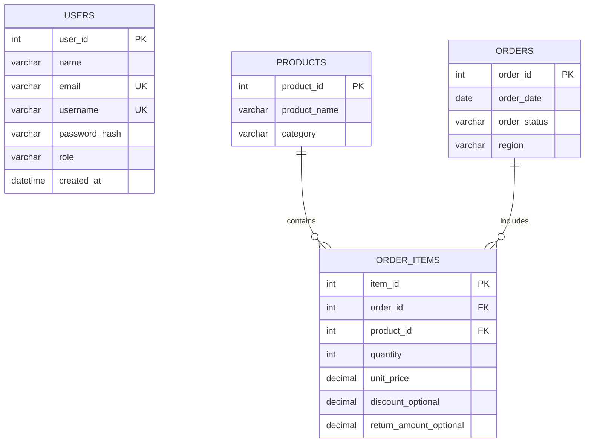

# 📊 OmniStore E-Commerce Business Intelligence (BI) Suite

An executive-level, full-stack business intelligence web application designed to monitor, analyze, and benchmark overall e-commerce store performance across revenue streams, product categories, geographic regions, and multi-year historical periods.

---

## 🎯 Executive Objectives & Business Scope

* **Macro Business Scope:** Aggregated corporate and store-level macro performance (strictly distinct from order-level transaction logs or individual customer behavior tracking).
* **Topline Accounting:** Consistent computation of **Gross Sales**, **Discounts**, **Returns & Refunds**, and **Net Sales**.
* **Order Economics:** Accurate tracking of **Valid Order Count**, **Net Average Order Value (AOV)**, and **Basket Size (Units per Order)**.
* **Period-over-Period Growth:** NumPy vectorized calculation of **Month-over-Month (MoM)** acceleration rates.
* **Multi-Dimensional Comparison:** Cross-tabulation matrices comparing **Product Categories** against **Geographic Regions**.
* **Risk & Quality Governance:** Continuous monitoring of **Order Cancellation Rate** and **Merchandise Return Rate**.

---

## 🧭 Application Structure & Navigation Flow

The application provides a seamless navigation system across six dedicated views:

1. **Home / Landing Page (`/`):**
   * SaaS-style hero section with the headline: *"Turn E-Commerce Data into Business Insights"*.
   * Executive KPI teaser cards showing live store-wide totals.
   * Six core feature modules highlighting business KPIs, revenue analysis, category economics, regional benchmarking, and growth tracking.
   * Live dashboard preview and technology stack showcase.
   * Quick-action CTA buttons: *"Get Started"* and *"Explore Dashboard"*.
2. **Login & Registration (`/login` & `/register`):**
   * Secure credential authentication with email/username and password.
   * Client-side show/hide password toggle.
   * PBKDF2/SHA-256 password hashing via `werkzeug.security`.
   * Form validation, duplicate account prevention, and flash messaging.
   * Automatic redirect to the requested dashboard route upon authentication.
   * 1-Click Academic Demo Credentials autofill (`admin@omnistore.bi` / `Admin123!`).
3. **Executive Dashboard (`/dashboard`):**
   * Five core management KPI cards: **Gross Sales**, **Net Sales**, **Valid Order Count**, **Average Order Value (Net AOV)**, and **Revenue Growth Percentage (MoM %)**.
   * Clear reporting period metadata (e.g. `2024–2026`) and currency standard (`USD $`).
   * Period-over-period previous month benchmark comparison.
   * Dynamic filtering across **Time Horizon (Year)**, **Product Category**, **Geographic Region**, and **Order Status**.
   * Visualization toggle between interactive Chart.js and server-rendered publication-ready Matplotlib figures.
   * Empty state handling when filter combinations yield zero records.
4. **Sales Analytics (`/analytics`):**
   * **Monthly Revenue Analysis:** Dual-line trajectory chart (Gross vs. Net), previous month comparative deltas ($ and %), and MoM growth velocity.
   * **Category Performance:** Ranked horizontal bar chart, detailed economics table, and a prominent highlight card for the **#1 Top-Performing Category**.
   * **Regional Performance:** Donut chart of regional contribution shares, territory table, and a full **Category $\times$ Region Cross-Tabulation Matrix**.
5. **KPI Documentation (`/documentation`):**
   * Formal reference sheet detailing the **7 core business performance metrics** with KaTeX LaTeX mathematical formulas, plain-text descriptions, and management utility.
   * Detailed explanations of data governance: cancelled orders exclusion, discount/refund deductions, NULL value imputation (`COALESCE/0.0`), duplicate order prevention via distinct sets, and zero-baseline NumPy safe division.
6. **Executive Report (`/report`) & Database Configuration (`/database`):**
   * Printable executive summary with a 4-quadrant Matplotlib visual canvas.
   * Live connection testing and migration tool between zero-config SQLite and production MySQL.

---

## 📐 Master KPI Formulas & Accounting Governance

| # | Metric | Category | Standard Accounting Formula | Governance & Treatment |
| :-: | :--- | :--- | :--- | :--- |
| **1** | **Gross Sales** | Revenue | $$\sum (\text{quantity} \times \text{unit\_price})$$ | Sum before markdowns; strictly excludes cancelled orders. |
| **2** | **Net Sales** | Revenue | $$\text{Gross Sales} - \text{Discounts} - \text{Returns}$$ | Top-line retained cashflow after deductions. |
| **3** | **Order Count** | Volume | $$\text{Count}(\text{Distinct Valid } \text{order\_id})$$ | Distinct orders with status $\neq$ `Cancelled`. Multi-item orders count as 1. |
| **4** | **Average Order Value** | Economics | $$\frac{\text{Net Sales}}{\text{Valid Order Count}}$$ | Average net spend per valid order. Safe division. |
| **5** | **Revenue Growth** | Velocity | $$\left(\frac{\text{Revenue}_t - \text{Revenue}_{t-1}}{\text{Revenue}_{t-1}}\right) \times 100\%$$ | NumPy percentage change; zero prior revenue safely yields 0.0%. |
| **6** | **Category Revenue** | Product | $$\sum_{i \in \text{Category}} \text{Net Sales}_i$$ | Net sales aggregated by product category (descending rank). |
| **7** | **Regional Revenue** | Geography | $$\sum_{o \in \text{Region}} \text{Net Sales}_o$$ | Net sales aggregated by territory with % share. |

---

## 🗄️ Relational Database Entities & Schema

The database architecture is defined in [schema.sql](file:///C:/Users/USER/.gemini/antigravity/scratch/ecommerce_bi_dashboard/schema.sql) and implemented in both SQLite and MySQL:



---

## 🔐 Default Demo Credentials

For local academic demonstrations and evaluation, an administrator account is pre-seeded automatically:

* **Username / Email:** `admin@omnistore.bi` (or `admin`)
* **Password:** `Admin123!`
* **Role:** `Executive Director`

You can also create custom accounts at any time via the registration page (`/register`).

---

## 🚀 How to Run the Application

### 1. Prerequisites
* Python 3.10+
* Packages installed: `flask`, `numpy`, `matplotlib`, `pandas`, `mysql-connector-python`

### 2. Configure Environment (Optional)
Copy [.env.example](file:///C:/Users/USER/.gemini/antigravity/scratch/ecommerce_bi_dashboard/.env.example) to `.env`:
```bash
cp .env.example .env
```

### 3. Launch the Server
```bash
python app.py
```
The server will bind to port 5000:
👉 **[http://127.0.0.1:5000](http://127.0.0.1:5000)**

---

## 🧪 Automated Test Suite

To run the automated verification suite:
```bash
python test_bi_suite.py
```

### Verification Coverage:
* Database schema creation & seeding of 2,200+ orders and 3,900+ items.
* User authentication, password hashing, and session lifecycle.
* Unauthenticated route protection (redirecting to `/login`).
* Mathematical KPI formula consistency ($Net = Gross - Discounts - Returns$).
* Cancelled orders exclusion rule.
* Multi-product order distinct count deduplication.
* Missing/null values imputation (0.00 default).
* Zero-revenue previous period safe division (NumPy).
* All 4 Matplotlib chart renderers.

---

## 📁 Project Directory Structure

```
ecommerce_bi_dashboard/
├── .env.example              # Environment variables template
├── app.py                    # Flask application controller & protected routes
├── database.py               # Dual DB layer (SQLite & MySQL), auth queries, seeding
├── kpi_engine.py             # Pandas & NumPy aggregation and MoM growth engine
├── charts.py                 # Matplotlib visualization generator (Base64 PNGs)
├── kpi_definitions.py        # 7 Core KPI definitions & technical governance rules
├── schema.sql                # Complete MySQL DDL specification (users, products, orders, items)
├── test_bi_suite.py          # Comprehensive 9-test unit & integration test suite
├── ecommerce_bi.db           # Pre-seeded SQLite database
├── static/
│   ├── css/
│   │   └── style.css         # Modern SaaS executive styling (navy, white, subtle accents)
│   └── js/                   # Client-side scripts
└── templates/
    ├── base.html             # Common navigation, KaTeX math engine, and footer layout
    ├── landing.html          # Public landing page with hero, features & preview
    ├── login.html            # Sign-in screen with show/hide password & demo autofill
    ├── register.html         # User registration with password validation
    ├── dashboard.html        # Executive KPI Dashboard (5 cards, filters, periods)
    ├── analytics.html        # Sales Analytics (monthly trajectory, categories, regions)
    ├── documentation.html    # Dedicated KPI Documentation & accounting governance
    ├── report.html           # Printable 4-quadrant executive brief
    └── database.html         # SQLite/MySQL switcher and schema inspector
```
